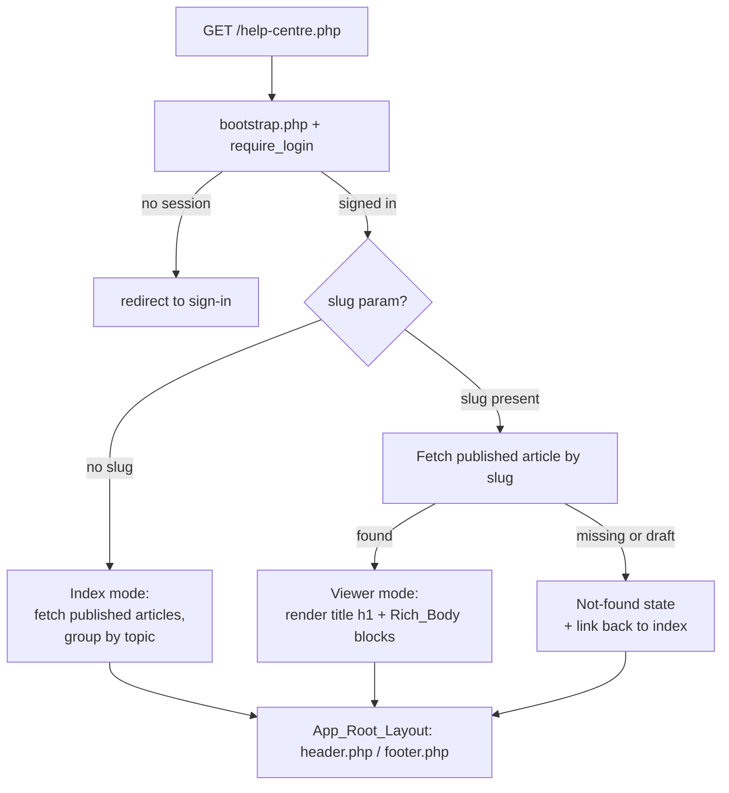

# Design Document — Help Centre

## Overview

The Help Centre is a top-level application-root module served from `/help-centre.php`. It stores help content in a new `help_articles` table, lists published articles grouped by topic (index mode), renders a single article with rich content blocks (viewer mode), and surfaces articles through the existing global search engine with the same gating as every other category.

The design follows patterns already present in the codebase:

- **Migration + seed**: `database/migrations/005_help_articles.sql` mirrors `004_district_events.sql` — idempotent `CREATE TABLE IF NOT EXISTS`, additive, and `INSERT ... SELECT ... WHERE NOT EXISTS` seed rows so re-running changes nothing.
- **Page chrome**: `/help-centre.php` uses the App_Root_Layout exactly like `technical-support.php` — `require_once __DIR__ . '/app/bootstrap.php'` → `require_login()` → set `$pageTitle/$heroTitle/$heroText/$breadcrumb` → `include __DIR__ . '/header.php'` … `include __DIR__ . '/footer.php'`. It does **not** use `dc/layout.php`.
- **Search**: `app/search-helpers.php` gains a `help` category and a `search_help_articles()` function shaped after `search_risk_assessments()` — PDO prepared `LIKE`, signed-in gating via `dc_context(false)`, normalised Search_Result_Row shape, and a `try/catch (Throwable)` that returns `[]` if the table is missing.
- **External links**: the existing convention is `target="_blank" rel="noopener noreferrer"` (see `header.php` search renderer). Action blocks reuse it.

## Request Flow



Search runs independently through `/search.php` and `/search-results.php`, both of which call `search_run()`, which now dispatches the `help` category to `search_help_articles()`.

## Data Model

### `help_articles` table

| Column       | Type                                 | Notes                                                           |
|--------------|--------------------------------------|-----------------------------------------------------------------|
| `id`         | `BIGINT UNSIGNED AUTO_INCREMENT PK`  | Primary key (Req 1.2).                                          |
| `slug`       | `VARCHAR(160) NOT NULL UNIQUE`       | URL-safe, unique (Req 1.3). Used in viewer URL.                 |
| `title`      | `VARCHAR(255) NOT NULL`              | Display title (Req 1.4).                                        |
| `summary`    | `VARCHAR(500) NOT NULL DEFAULT ''`   | Plain-text listing/search subtitle (Req 1.5).                  |
| `keywords`   | `VARCHAR(500) NOT NULL DEFAULT ''`   | Search terms (Req 1.6).                                        |
| `body`       | `JSON NOT NULL`                      | Rich_Body = ordered array of blocks (Req 1.7).                 |
| `topic`      | `VARCHAR(120) NOT NULL DEFAULT ''`   | Index grouping heading (Req 1.8).                             |
| `status`     | `ENUM('draft','published') NOT NULL DEFAULT 'draft'` | Publication state (Req 1.9).             |
| `sort_order` | `INT NOT NULL DEFAULT 0`             | Intra-topic ordering (Req 1.10).                              |
| `created_at` | `TIMESTAMP NOT NULL DEFAULT CURRENT_TIMESTAMP` | Creation time (Req 1.11).                          |
| `updated_at` | `TIMESTAMP NOT NULL DEFAULT CURRENT_TIMESTAMP ON UPDATE CURRENT_TIMESTAMP` | Last-modified (Req 1.11). |

Index: `KEY idx_help_articles_status_topic (status, topic, sort_order)` to support the grouped, ordered index query (Req 1.12).

`body` uses MySQL's native `JSON` type. If the deployment target predates JSON support this degrades to `LONGTEXT` with no code change (the app always `json_decode`s the column); the migration uses `JSON` and falls back is documented but not required for the current MySQL/MariaDB target.

### Rich_Body block model

`body` is a JSON array of blocks rendered in stored order (Req 3.2). Each block is an object with a `type` discriminator:

```json
[
  { "type": "paragraph", "text": "Plain text. Rendered escaped." },
  { "type": "heading", "level": 2, "text": "Section heading" },
  { "type": "steps", "items": ["First step", "Second step", "Third step"] },
  {
    "type": "action",
    "actions": [
      { "label": "Add a member", "url": "/dc/add-user.php", "external": false, "style": "primary" },
      { "label": "Open Microsoft 365", "url": "https://outlook.cloud.microsoft/", "external": true }
    ]
  }
]
```

Block types:

- **`paragraph`** — `{ type, text }`. Rendered as `<p>` with escaped text.
- **`heading`** — `{ type, level, text }`. `level` is normalised to 2–6 (the article `title` is the only `<h1>`), clamped so headings never skip a level (Req 6.1, 6.2).
- **`steps`** — `{ type, items: string[] }`. Rendered as `<ol><li>…</li></ol>` so order/position is conveyed to assistive tech (Req 3.3, 6.4).
- **`action`** — `{ type, actions: Action[] }` where an `Action` is `{ label, url, external?, style? }`.
  - `label` (required): descriptive link text, rendered as the visible text — never the bare URL (Req 3.4, 6.3).
  - `url` (required): internal (`/dc/...`) or external target.
  - `external` (optional, default `false`): when `true`, rendered with `target="_blank" rel="noopener noreferrer"` plus a visually/aria-conveyed "(opens in a new tab)" affordance (Req 3.5, 6.6).
  - `style` (optional): `primary` | `secondary`; cosmetic CSS class only, defaulted when absent.

**Validation**: the renderer is defensive. Unknown block types are skipped; blocks missing required fields are skipped. Decoding is `json_decode($row['body'], true)`; a non-array result (null/corrupt JSON) renders as an empty body rather than erroring. No stored value is ever emitted without escaping.

## Components

### 1. Migration — `database/migrations/005_help_articles.sql`

Structure mirrors `004_district_events.sql`:

```sql
-- Migration 005: Help articles
CREATE TABLE IF NOT EXISTS help_articles (
    id          BIGINT UNSIGNED NOT NULL AUTO_INCREMENT,
    slug        VARCHAR(160)  NOT NULL,
    title       VARCHAR(255)  NOT NULL,
    summary     VARCHAR(500)  NOT NULL DEFAULT '',
    keywords    VARCHAR(500)  NOT NULL DEFAULT '',
    body        JSON          NOT NULL,
    topic       VARCHAR(120)  NOT NULL DEFAULT '',
    status      ENUM('draft','published') NOT NULL DEFAULT 'draft',
    sort_order  INT           NOT NULL DEFAULT 0,
    created_at  TIMESTAMP NOT NULL DEFAULT CURRENT_TIMESTAMP,
    updated_at  TIMESTAMP NOT NULL DEFAULT CURRENT_TIMESTAMP ON UPDATE CURRENT_TIMESTAMP,
    PRIMARY KEY (id),
    UNIQUE KEY uq_help_articles_slug (slug),
    KEY idx_help_articles_status_topic (status, topic, sort_order)
) ENGINE=InnoDB DEFAULT CHARSET=utf8mb4;

-- Idempotent seed: one INSERT ... SELECT per article, guarded by slug.
INSERT INTO help_articles (slug, title, summary, keywords, body, topic, status, sort_order)
SELECT 'adding-new-members', 'Adding new members to the District App', '…',
       'add member user account new leader', '[ … JSON … ]', 'People & Access', 'published', 10
FROM DUAL
WHERE NOT EXISTS (SELECT 1 FROM help_articles WHERE slug = 'adding-new-members');
-- … one guarded INSERT per remaining article …
```

`CREATE TABLE IF NOT EXISTS` plus slug-guarded `INSERT ... SELECT ... WHERE NOT EXISTS` make re-running the migration a no-op (Req 1.13, 5.9).

### 2. Page — `/help-centre.php`

```php
<?php
declare(strict_types=1);
require_once __DIR__ . '/app/bootstrap.php';
require_login();                       // Req 2.3 — redirects when no session

$appName   = app_config('APP_NAME', 'Irwell Valley Leader Tool');
$slug      = isset($_GET['slug']) ? trim((string) $_GET['slug']) : '';
$heroTitle = 'Help Centre';
$pageTitle = 'Help Centre | ' . $appName;
$breadcrumb = '<a href="/index.php">Home</a> / Help Centre';

if ($slug === '') {
    // Index mode (Req 2.4–2.9)
    $articles = help_published_articles();           // grouped-ready list
    $grouped  = help_group_by_topic($articles);      // topic => [article,…] ordered
} else {
    // Viewer mode (Req 3.x)
    $article = help_find_published_article($slug);   // null if missing or draft
}

include __DIR__ . '/header.php';
// ... render index or viewer or not-found ...
include __DIR__ . '/footer.php';
```

Data access helpers (defined in the page or a small `app/help-helpers.php`):

- `help_published_articles(): array` — `SELECT … WHERE status='published' ORDER BY topic ASC, sort_order ASC, title ASC`. Returns normalised rows with `body` already `json_decode`d. Wrapped in `try/catch` returning `[]` if the table is absent.
- `help_group_by_topic(array $rows): array` — preserves the SQL ordering, keyed by `topic` (Req 2.5, 2.6).
- `help_find_published_article(string $slug): ?array` — prepared `SELECT … WHERE slug = ? AND status = 'published' LIMIT 1`. A draft or unknown slug returns `null`, driving the not-found state (Req 3.7, 3.8).

### 3. Rich_Body renderer

A small, self-contained render helper used by the viewer. Every stored value passes through `htmlspecialchars(..., ENT_QUOTES, 'UTF-8')` (Req 3.6).

```php
function help_render_body(array $blocks): string
{
    $html = '';
    foreach ($blocks as $block) {
        if (!is_array($block) || !isset($block['type'])) {
            continue;                                   // defensive skip
        }
        $html .= match ((string) $block['type']) {
            'paragraph' => help_render_paragraph($block),
            'heading'   => help_render_heading($block),   // level clamped 2..6, no skips
            'steps'     => help_render_steps($block),      // <ol><li>…</li></ol>
            'action'    => help_render_actions($block),    // labelled links
            default     => '',                              // unknown type skipped
        };
    }
    return $html;
}

function help_render_action_link(array $a): string
{
    $label = htmlspecialchars((string) ($a['label'] ?? ''), ENT_QUOTES, 'UTF-8');
    $url   = htmlspecialchars((string) ($a['url'] ?? '#'), ENT_QUOTES, 'UTF-8');
    if ($label === '' || ($a['url'] ?? '') === '') {
        return '';
    }
    $external = !empty($a['external']);
    $style    = in_array($a['style'] ?? '', ['primary', 'secondary'], true) ? $a['style'] : 'primary';
    $rel      = $external ? ' target="_blank" rel="noopener noreferrer"' : '';
    $hint     = $external
        ? ' <span class="lt-help-ext" aria-hidden="true">↗</span><span class="visually-hidden"> (opens in a new tab)</span>'
        : '';
    return '<a class="lt-help-action lt-help-action--' . $style . '" href="' . $url . '"' . $rel . '>'
         . $label . $hint . '</a>';
}
```

Heading rendering tracks the previous level and clamps each block heading so it is always `>= 2` and at most one greater than the previous rendered level — guaranteeing no skipped levels below the `<h1>` title (Req 6.1, 6.2). Steps always emit `<ol>` with one `<li>` per item (Req 3.3, 6.4). Native `<a>`/`<button>` elements keep links keyboard-reachable and operable (Req 6.5).

### 4. Search integration — `app/search-helpers.php`

Add the category:

```php
function search_categories(): array
{
    return [
        'module'   => 'Module',
        'calendar' => 'Calendar',
        'risk'     => 'Risk Assessment',
        'person'   => 'Person',
        'help'     => 'Help',          // Req 4.1
    ];
}
```

Wire the dispatch in `search_run()`'s `match()` (Req 4.5):

```php
$rows = match ($category) {
    'module'   => search_modules($query, $perCategory),
    'calendar' => search_calendar_events($query, $perCategory),
    'risk'     => search_risk_assessments($query, $perCategory),
    'person'   => search_people($query, $perCategory),
    'help'     => search_help_articles($query, $perCategory),   // new
    default    => [],
};
```

New function, shaped after `search_risk_assessments()`:

```php
function search_help_articles(string $query, int $limit): array
{
    if ($query === '') {
        return [];                                   // Req 4.7
    }

    $ctx = dc_context(false);
    if (empty($ctx['is_signed_in'])) {
        return [];                                   // Req 4.9
    }

    $like   = '%' . $query . '%';
    $sql = "
        SELECT slug, title, summary
        FROM help_articles
        WHERE status = 'published'                     -- Req 4.8
          AND (title LIKE ? OR summary LIKE ? OR keywords LIKE ?)   -- Req 4.3
        ORDER BY title ASC
        LIMIT " . (int) $limit;                         // Req 4.6

    try {
        $stmt = db()->prepare($sql);
        $stmt->execute([$like, $like, $like]);
        $rows = $stmt->fetchAll(PDO::FETCH_ASSOC);
    } catch (Throwable $e) {
        return [];                                    // Req 4.10 — table missing etc.
    }

    $out = [];
    foreach ($rows as $row) {
        $out[] = [
            'category' => 'help',
            'badge'    => 'Help',
            'title'    => (string) ($row['title'] ?? ''),
            'subtitle' => (string) ($row['summary'] ?? ''),
            'url'      => '/help-centre.php?slug=' . rawurlencode((string) ($row['slug'] ?? '')),
            'external' => false,
        ];                                            // Req 4.4
    }

    return $out;
}
```

This reuses the established LIKE/prepared-statement, signed-in gating, normalised-row and `try/catch` conventions, so help results behave identically to the other categories in both the dropdown and the full results page.

## Seed Content Plan

14 articles seeded published, each with a topic, keywords, step instructions where applicable, and an Action_Block pointing at a real target.

| # | Slug | Title | Topic | Primary Action target(s) |
|---|------|-------|-------|--------------------------|
| 1 | `adding-new-members` | Adding new members to the District App | People & Access | `/dc/add-user.php` |
| 2 | `adding-an-event` | Adding an event to the calendar | Events | `/dc/add-event.php` |
| 3 | `searching-risk-assessments` | Searching risk assessments | Risk Assessments | `/dc/risk-assessments.php`, `/dc/download-risk-assessment.php` |
| 4 | `editing-events` | Editing an event | Events | `/dc/manage-event.php`, `/dc/event.php` |
| 5 | `approving-events` | Approving events | Events | `/dc/reviewer/` |
| 6 | `updating-your-profile` | Updating your profile | People & Access | `/profile.php` |
| 7 | `creating-a-district-email` | Creating a District email for someone | Email & Microsoft 365 | `/group-manager.php` |
| 8 | `using-a-shared-mailbox` | Using a shared mailbox | Email & Microsoft 365 | `https://outlook.cloud.microsoft/` (external) |
| 9 | `why-a-shared-mailbox` | Why the District uses a shared mailbox | Email & Microsoft 365 | `https://outlook.cloud.microsoft/` (external) |
| 10 | `navigating-the-calendar` | Viewing and navigating the District Calendar | Events | `/dc/event.php` |
| 11 | `finding-a-glv` | Finding and contacting a Group Lead Volunteer | People & Access | `/group-manager.php` |
| 12 | `requesting-support` | Requesting technical support | Getting Help | `/technical-support.php` |
| 13 | `access-levels-and-roles` | Understanding access levels and roles | People & Access | `/group-manager.php` |
| 14 | `logging-in-with-microsoft` | Logging in via Microsoft | Email & Microsoft 365 | `https://outlook.cloud.microsoft/` (external) |

Articles 1–9 are the explicit set (Req 5.1); 10–14 are the additional set (Req 5.2). Topic grouping (Req 5.6) uses: **Events**, **Email & Microsoft 365**, **People & Access**, **Risk Assessments**, **Getting Help**. Every article is `status = 'published'` (Req 5.7), has task-based `steps` blocks where it describes a page-based task (Req 5.3), carries an Action_Block to a real target (Req 5.4), marks the Microsoft 365 action `external` (Req 5.5), and has populated `keywords` (Req 5.8). All seed inserts live in migration 005 (Req 5.9).

## Error Handling

- **Missing or draft slug** → `help_find_published_article()` returns `null`; the viewer renders a not-found state (heading, explanatory text, and a link back to the index) within the normal App_Root_Layout (Req 3.7, 3.8, 3.9). No HTTP error page is required.
- **Missing table** → all data access and search are wrapped in `try/catch (Throwable)` returning `[]`/`null`, so the Help Centre and search degrade gracefully before the migration is applied (Req 4.10).
- **Corrupt/empty JSON body** → `json_decode` returning a non-array yields an empty rendered body rather than an exception.
- **Unknown/malformed blocks** → skipped by the renderer's defensive `match`/field checks.

## Security

- **Output escaping**: every stored value (`title`, `summary`, block `text`, step items, action `label`, action `url`) is passed through `htmlspecialchars(..., ENT_QUOTES, 'UTF-8')` before output, so stored content is rendered as text, never executable markup (Req 3.6).
- **Prepared statements**: all queries use PDO prepared statements with bound parameters (listing, viewer lookup, search LIKE), consistent with the rest of `search-helpers.php`.
- **Auth gating**: `require_login()` guards the page (Req 2.3); search results are gated by `dc_context(false)['is_signed_in']` identically to the other categories (Req 4.9). Help content is non-sensitive and visible to any signed-in user, so no per-group scoping is applied — but the signed-in gate still matches the engine's discipline.
- **External links**: `rel="noopener noreferrer"` prevents reverse-tabnabbing on new-tab links.

## Testing Approach

Dual approach: property-based tests for input-varying logic, example/edge tests for fixed cases and data.

- **Renderer** (pure function over block arrays): property tests for escaping, block order, heading-level discipline, ordered-list steps, and external-link rel/text. These are the highest-value targets and run cheaply in-memory.
- **Search**: property tests over seeded article sets for result shape, published-only filtering, and the limit cap; example/edge tests for empty query, no session, and missing table.
- **Index/viewer queries**: property tests for published-only listing and topic ordering; example test for draft/unknown slug → not found.
- **Migration**: example tests — apply once then again, assert stable seed count (idempotence); assert duplicate-slug insert fails; assert the 14 expected articles exist, published, with expected topics and action targets.

Property tests run a minimum of 100 iterations and are tagged `Feature: help-centre, Property {n}: {text}`. Infrastructure-ish checks (table existence, migration application) are example/smoke tests, not property tests.

## Correctness Properties

*A property is a characteristic or behavior that should hold true across all valid executions of a system — a formal statement about what the system should do. Properties serve as the bridge between human-readable specifications and machine-verifiable correctness guarantees.*

### Property 1: Stored content is always escaped

*For any* Help_Article field value or Rich_Body text/label/step containing HTML metacharacters, the rendered output SHALL contain those characters in escaped form and SHALL NOT contain the unescaped markup.

**Validates: Requirements 3.6**

### Property 2: Index lists exactly the published articles

*For any* set of Help_Articles with arbitrary `status` values, the Help_Centre_Index result SHALL contain exactly those articles whose `status` is `published` and no article whose `status` is `draft`.

**Validates: Requirements 2.4, 2.8**

### Property 3: Topic ordering is stable

*For any* set of published Help_Articles sharing a Topic, the Help_Centre_Index SHALL order them by `sort_order` ascending and then by `title` ascending.

**Validates: Requirements 2.6**

### Property 4: Blocks render in stored order

*For any* Rich_Body block array, the Article_Viewer SHALL render the blocks in the same order they appear in storage.

**Validates: Requirements 3.2**

### Property 5: Steps render as an ordered list

*For any* steps block with N items, the Article_Viewer SHALL render exactly one ordered-list element containing N list items in item order.

**Validates: Requirements 3.3, 6.4**

### Property 6: Heading levels never skip and stay below the title

*For any* Rich_Body containing heading blocks, every rendered heading SHALL be at a level greater than the article title's level and SHALL NOT skip a heading level relative to the previously rendered heading.

**Validates: Requirements 6.1, 6.2**

### Property 7: External actions open safely in a new context

*For any* Action_Block action, the rendered link SHALL include `target="_blank"`, `rel="noopener noreferrer"`, and an assistive-technology-conveyed new-tab indication if and only if the action is marked external.

**Validates: Requirements 3.5, 6.6**

### Property 8: Action links use descriptive text

*For any* Action_Block action, the rendered link's visible text SHALL be the action's `label` and SHALL NOT be the bare target URL.

**Validates: Requirements 3.4, 6.3**

### Property 9: Only published articles are viewable

*For any* slug, the Article_Viewer SHALL render the article if and only if a Help_Article with that slug exists and has `status` equal to `published`; otherwise it SHALL render the not-found state.

**Validates: Requirements 3.1, 3.7, 3.8**

### Property 10: Help search rows are well-formed and published-only

*For any* non-empty query evaluated for a signed-in user, every row returned by `search_help_articles()` SHALL have `category` = `help`, `badge` = `Help`, `title` = the article `title`, `subtitle` = the article `summary`, `url` = `/help-centre.php?slug={slug}`, `external` = `false`, and SHALL correspond to an article whose `status` is `published`.

**Validates: Requirements 4.3, 4.4, 4.8**

### Property 11: Help search respects the result limit

*For any* query and limit N, `search_help_articles($query, N)` SHALL return at most N rows.

**Validates: Requirements 4.6**
